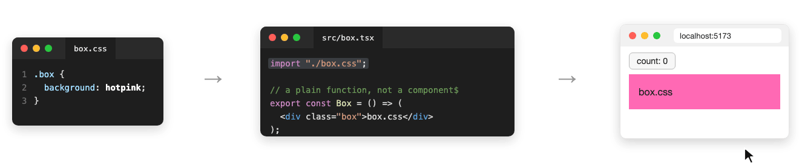

# Qwik: a css edit reloads the page when a plain function imports the css



`src/box.tsx` imports `box.css` and exports `Box`, a plain function that the route renders. When `box.css` changes, Vite swaps the stylesheet and the box turns lightblue. Half a second later Qwik reloads the page, and the counter, which was at 3, is back at 0.

## What happens

1. `box.css` changes. Vite sends a `css-update` for `/src/box.css?direct`, and the box turns lightblue.
2. In the SSR environment, Qwik's `hotUpdate` sees `box.css`. Its url is not a source file, so Qwik names its importer `src/box.tsx` as changed and sends `qwik:hmr` with `files: ["/src/box.tsx"]`.
3. No `component$` lives in `src/box.tsx`, so no component answers the event. After 500 ms the client logs `HMR update did not match active code, reloading the page` and reloads.

If `Box` is a `component$`, the counter keeps its value. Qwik still sends `qwik:hmr` for `src/box.tsx`, and `Box` renders again, although only its css changed.

## Try it

```sh
npm install
npm run dev
```

Open http://localhost:5173, click the button a few times, then change `background` in `src/box.css` from `hotpink` to `lightblue` and save.

## Why

Qwik's `hotUpdate` sends the JS importers of every SSR module whose url is not a source file ([vite.ts](https://github.com/QwikDev/qwik/blob/%40qwik.dev/core%402.0.0-rc.3/packages/qwik-vite/src/plugins/vite.ts#L681-L717)):

```ts
// Some non-source imports (e.g. .css?inline) are type 'js' but their URL
// is not a JS/TS file. For those, emit their JS importers instead, since
// the component that needs to re-render is the importer.
```

The comment names `.css?inline`, whose content ends up in the importer's render. In the SSR environment a plain `import "./box.css"` is a module of type `js` too, so it takes the same branch. Vite already updates that stylesheet in the browser, so its importer needs no new render.

The client bridge then reloads the page when no live component handles the event within 500 ms ([vite.ts](https://github.com/QwikDev/qwik/blob/%40qwik.dev/core%402.0.0-rc.3/packages/qwik-vite/src/plugins/vite.ts#L74-L92)).

Skipping css that Vite updates itself would fix the repro, for example by walking the importers only for an `?inline` import.
